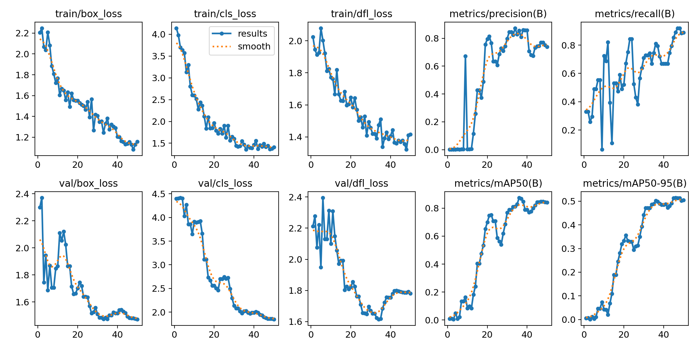
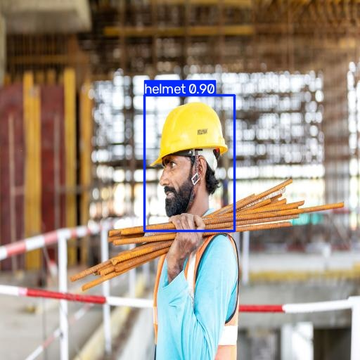
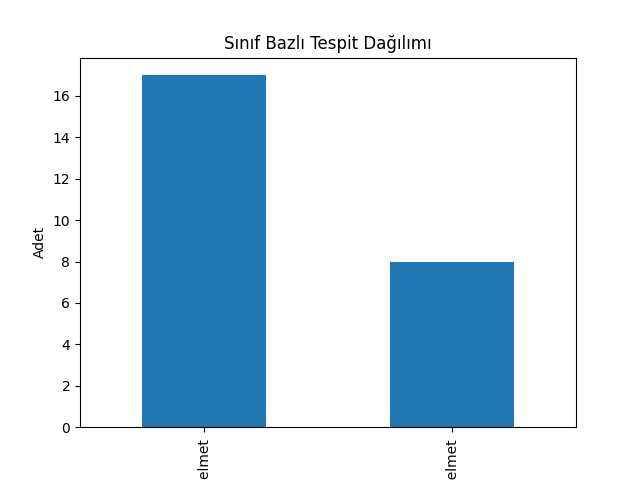

# Saha Güvenliği Tespiti — YOLOv8 ile Baret (Helmet) Tespit Modeli

Bu proje, inşaat/maden sahalarında yaygın bir iş güvenliği ihtiyacı olan **baret takılıp takılmadığının otomatik tespiti**ni, kendi topladığım ve etiketlediğim küçük bir veri setiyle sıfırdan eğitilmiş bir YOLOv8 modeli üzerinden gerçekleştiriyor. Tespit sonuçları bir SQL veritabanına yazılıyor ve SQL sorgularıyla analiz ediliyor.

Amaç, hazır bir modeli çalıştırmak değil; **veri toplama → etiketleme → model eğitimi → sonuçların SQL ile sorgulanıp yorumlanması** sürecinin tamamını uçtan uca deneyimlemekti.

---

## 1. Veri Seti

- **Kaynak:** Pexels / Pixabay üzerinden toplanan 67 görsel (inşaat sahası, işçi fotoğrafları)
- **Etiketleme:** Roboflow üzerinde manuel olarak, her insanın **kafa bölgesi** (kask varsa kask dahil, çeneye kadar) kutulanarak yapıldı
- **Sınıflar:** `helmet` (baret takılı), `no_helmet` (baret takılı değil — şapka/bere dahil)
- **Bölünme:** 54 görsel train, 13 görsel valid (~%80/%20)
- **Not:** Veri seti küçük ölçekli olduğu için ayrı bir test seti oluşturulmadı; valid seti hem doğrulama hem de görsel örnekleme için kullanıldı.

Etiketleme kuralı bilinçli olarak belirlendi: sert, endüstriyel baretler `helmet`; kumaş şapka, bere, kasket dahil her türlü baret-dışı baş giyimi `no_helmet` sayıldı. Bu, güvenlik standartlarına uygun, tutarlı bir ayrım sağlamak içindi.

---

## 2. Model ve Eğitim

- **Mimari:** YOLOv8n (nano) — `ultralytics` kütüphanesi
- **Yöntem:** Transfer learning — COCO veri setiyle önceden eğitilmiş ağırlıklardan (`yolov8n.pt`) başlanıp, kendi veri setimizle ince ayar (fine-tuning) yapıldı. Bu, 67 gibi küçük bir veri setinden anlamlı sonuç alınabilmesini sağlayan temel neden; sıfırdan eğitimle bu kadar az veriyle model hiçbir şey öğrenemezdi.
- **Parametreler:** `epochs=50`, `imgsz=640`, `batch=8`
- **Donanım:** Google Colab, Tesla T4 GPU (ücretsiz katman)
- **Eğitim süresi:** ~0.02 saat (≈1 dakika)

---

## 3. Sonuçlar ve Yorumlama

### mAP50 nedir, bize ne söylüyor?

**mAP50 (mean Average Precision @ IoU=0.5)**, modelin bir nesneyi hem **doğru konumda** hem de **doğru sınıfla** ne sıklıkla bulduğunu ölçen, nesne tespitinde en yaygın referans metriktir. "50", modelin çizdiği kutunun gerçek (ground truth) kutuyla en az %50 örtüşmesi (IoU) şartını ifade eder. 1.0'a ne kadar yakınsa model o kadar güvenilir demektir. Bu metrik bize modelin *genel isabet oranını* verir — ama tek başına modelin *hangi tür hatalar* yaptığını göstermez; bunun için tespit detaylarına (SQL sorgularına) inmek gerekiyor.

| Sınıf | Precision | Recall | mAP50 | mAP50-95 |
|---|---|---|---|---|
| **Tümü** | 0.745 | 0.890 | **0.845** | 0.511 |
| `helmet` | 0.844 | 1.000 | 0.912 | 0.535 |
| `no_helmet` | 0.645 | 0.779 | 0.778 | 0.486 |

**Yorum:** Genel mAP50 (0.845), 67 görsellik bir veri seti için oldukça güçlü bir sonuç. `helmet` sınıfı, `no_helmet`'e göre belirgin şekilde daha iyi öğrenilmiş (0.912 vs 0.778). Bunun olası nedeni, `no_helmet` sınıfının görsel çeşitliliğinin daha fazla olması — çıplak kafa, farklı saç tipleri, şapka, bere gibi birbirinden çok farklı görünümlerin hepsi tek bir sınıfta toplanıyor, oysa `helmet` sınıfı görsel olarak daha tutarlı (sert, parlak, kubbe biçimli nesneler).

### SQL sorgularıyla derinlemesine analiz

Valid seti üzerinde model ile tahmin yapılıp sonuçlar bir SQLite veritabanına (`detections.db`) yazıldı. Aşağıdaki sorgular, mAP50'nin tek başına göstermediği detayları ortaya çıkarıyor:

```sql
SELECT detected_class, COUNT(*) as adet, ROUND(AVG(confidence), 3) as ort_guven
FROM detections
GROUP BY detected_class
```

| Sınıf | Tespit Adedi | Ortalama Güven |
|---|---|---|
| `helmet` | 8 | 0.570 |
| `no_helmet` | 17 | 0.664 |

**Bu tablo ile mAP50 tablosunu kıyaslayınca ortaya çıkan çelişki (ve açıklaması):**

mAP50'ye göre model `helmet` sınıfında daha başarılıydı (0.912), ama SQL sorgusuna göre `helmet` tespitlerinin **ortalama güven skoru** (0.570) `no_helmet`'ten (0.664) daha düşük çıktı. Bu iki metrik farklı şeyi ölçtüğü için çelişki değil, tamamlayıcı bir bilgi:

- **mAP50**, tahminlerin gerçek etiketlerle ne kadar örtüştüğünü (doğruluğunu) ölçer.
- **Ortalama confidence**, modelin tahminlerine ne kadar "emin" olduğunu ölçer — ama emin olduğu tahmin **yanlış da olabilir.**

Ayrıca dikkat çeken bir nokta: valid setindeki gerçek (ground truth) `no_helmet` nesne sayısı 14 iken, model 17 tespit üretti. Bu **fazladan 3 tespit**, olası yanlış pozitif (false positive) örnekleri işaret ediyor — yani model bazı durumlarda `no_helmet` sınıfını yüksek güvenle ama hatalı şekilde tahmin etmiş olabilir. `helmet` sınıfında ise tespit sayısı (8) gerçek instance sayısıyla (8) birebir örtüşüyor; model daha az ama daha isabetli tahmin üretmiş.

**Sonuç:** Model `helmet` sınıfında *temkinli ve isabetli*, `no_helmet` sınıfında ise *daha az temkinli ve zaman zaman hatalı* davranıyor. Bu, 67 görsellik veri setinin `no_helmet` sınıfındaki görsel çeşitliliği tam karşılayamamasından kaynaklanıyor olabilir; daha büyük ve dengeli bir veri seti ile bu fark azaltılabilir.

```sql
SELECT image_name, detected_class, confidence
FROM detections
WHERE confidence < 0.5
ORDER BY confidence ASC
```
Bu sorgu, modelin en çok zorlandığı (düşük güvenli) tespitleri listeler — hangi görsellerde modelin kararsız kaldığını somut olarak gösteriyor, gelecekte veri setine hangi tür örneklerin eklenmesi gerektiğine (örn. daha fazla düşük ışıklı veya uzak plan sahne) dair fikir veriyor.

```sql
SELECT image_name, COUNT(*) as tespit_sayisi
FROM detections
GROUP BY image_name
ORDER BY tespit_sayisi DESC
LIMIT 5
```
Bu sorgu, en kalabalık (en çok kişi içeren) sahneleri öne çıkarır — modelin çoklu nesne tespitindeki tutarlılığını görsel olarak incelemek için kullanılabilir.

---

## 4. Kullanılan Teknolojiler

- **Python** — veri işleme, model eğitimi, otomasyon
- **YOLOv8 (Ultralytics)** — nesne tespiti, transfer learning
- **Roboflow** — veri etiketleme ve veri seti versiyonlama
- **SQLite (SQL)** — tespit sonuçlarının depolanması ve sorgulanması
- **Pandas / Matplotlib** — sonuçların analiz ve görselleştirilmesi
- **Google Colab** — GPU destekli eğitim ortamı

---

## 5. Nasıl Çalıştırılır

1. Bu repodaki `helmetprojects.ipynb` dosyasını [Google Colab](https://colab.research.google.com)'da açın (File → Upload notebook, ya da doğrudan GitHub linkiyle açma).
2. Runtime → Change runtime type → **GPU (T4)** seçin.
3. İlk hücreleri sırasıyla çalıştırarak gerekli kütüphaneleri kurun:
   ```
   !pip install ultralytics roboflow
   ```
4. Veri setini yeniden indirmek isterseniz kendi Roboflow API key'inizi kullanmanız gerekir (güvenlik nedeniyle bu repoda paylaşılmamıştır). `data.yaml` dosyası veri seti yapısını (sınıflar, train/valid yolları) göstermektedir.
5. Modeli sıfırdan eğitmek için:
   ```python
   from ultralytics import YOLO
   model = YOLO("yolov8n.pt")
   model.train(data="data.yaml", epochs=50, imgsz=640, batch=8)
   ```
6. Bu repoda paylaşılan eğitilmiş ağırlıklarla (`best.pt`) doğrudan tahmin yapmak için:
   ```python
   from ultralytics import YOLO
   model = YOLO("best.pt")
   model.predict("gorsel.jpg", save=True)
   ```

## 6. Görseller

### Eğitim Sonuçları


### Örnek Tahmin


### Sınıf Dağılımı

